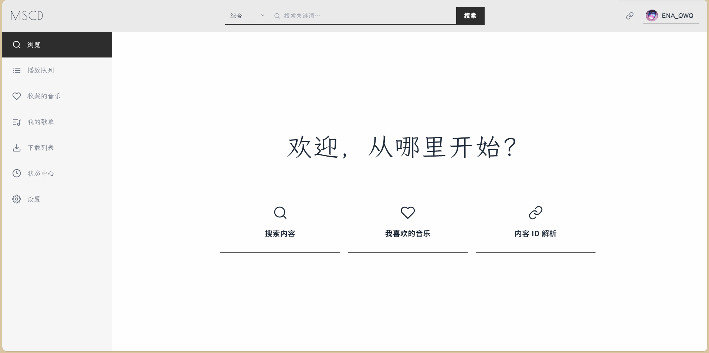
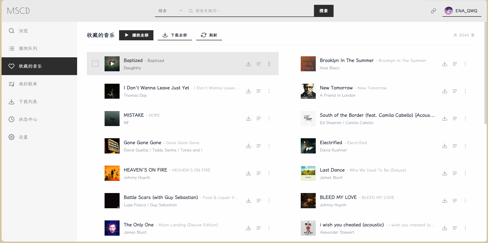
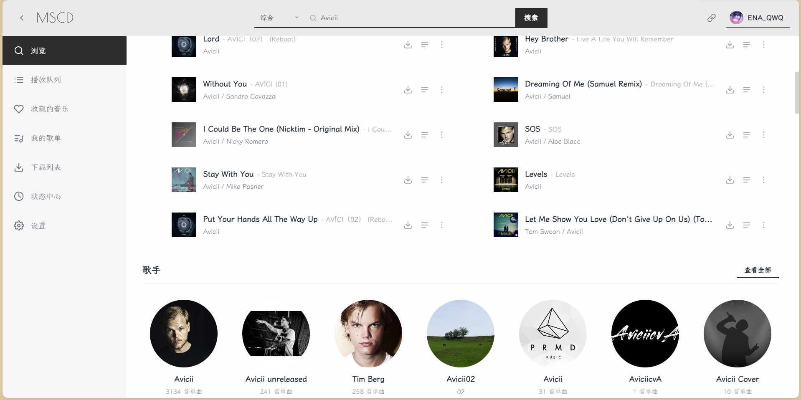
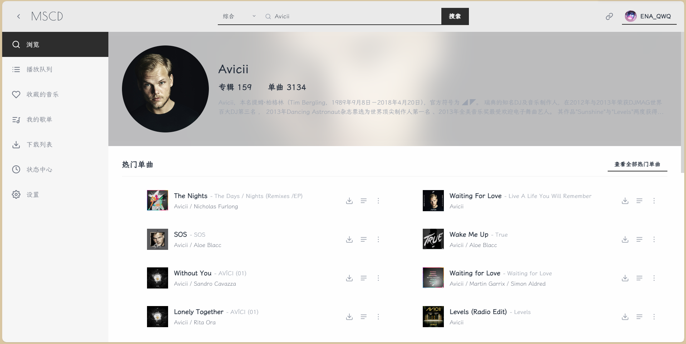
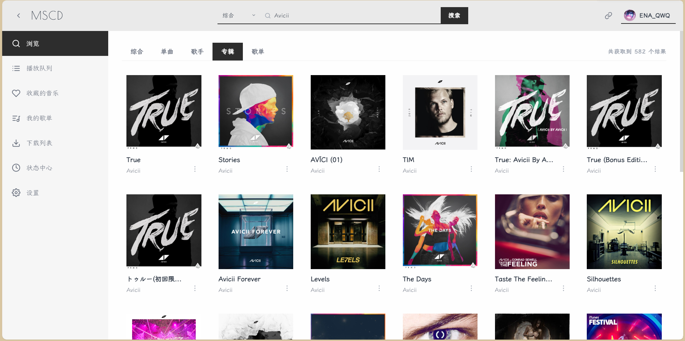
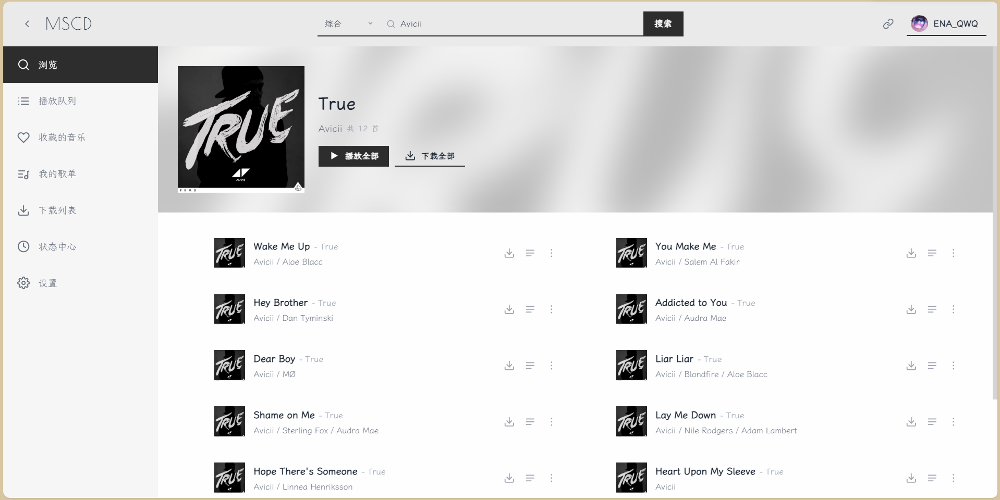
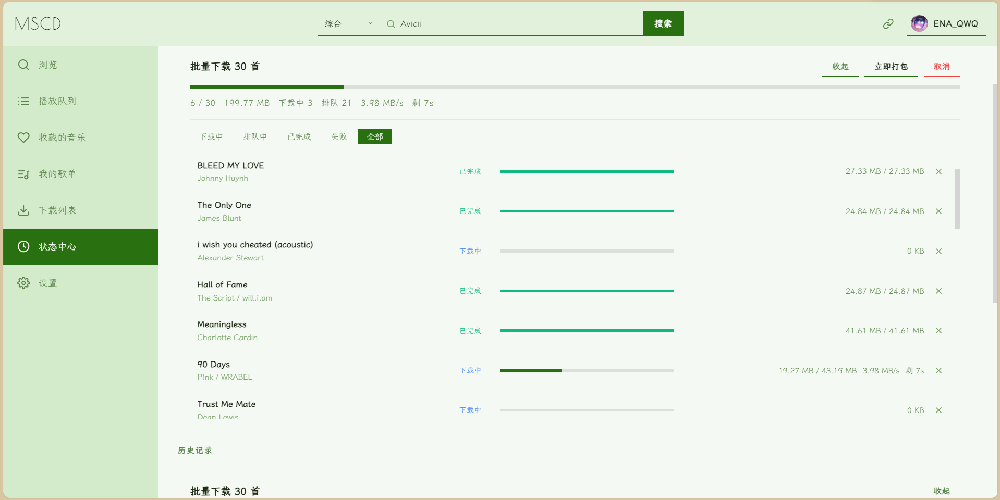
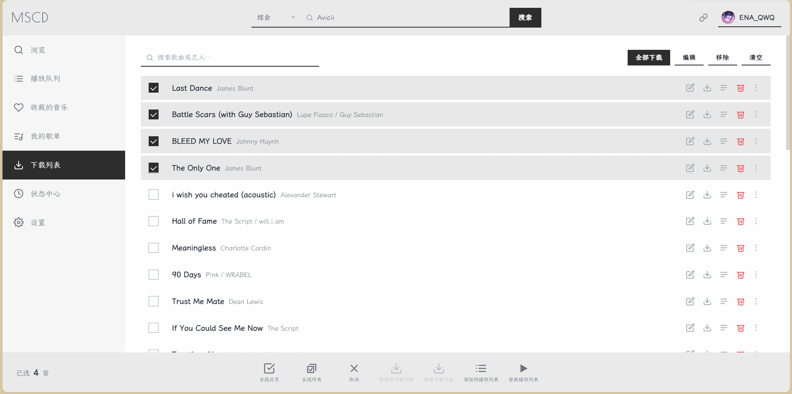
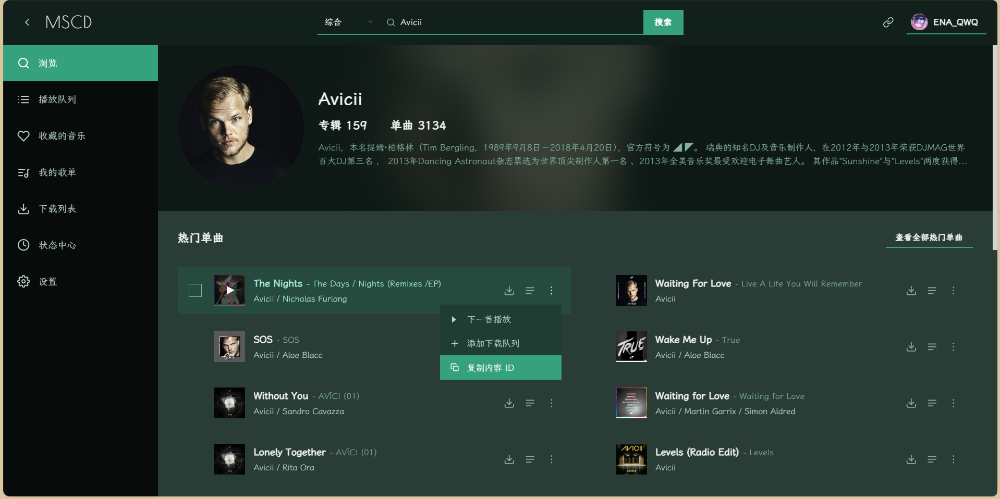
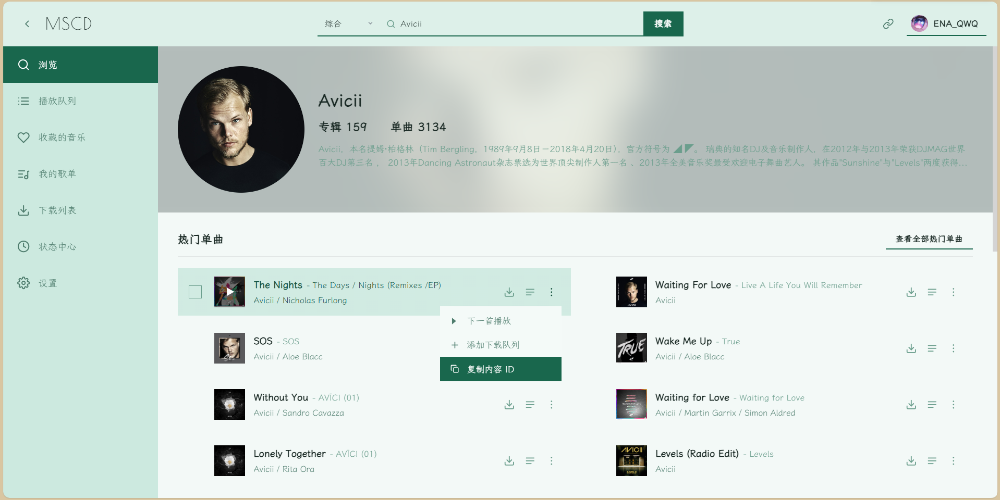

<div align="center">

<br />
<a href="https://github.com/ENA-QWQ/MSCD/blob/main/LICENSE"></a>
<a href="https://pages.cloudflare.com/"></a>


</div>

# MSCD

> 自述文件部分由 LLM 生成。

以 NeteaseCloudMusicApi 为主后端、Meting API 作音频源的 Web 音乐客户端。原生 ES Modules，clone 即可运行，无构建步骤，部署于 Cloudflare Pages，可选 Pages Functions 作为边缘代理。

本项目仅为客户端实现，不提供音乐存储与检索服务。所有数据来源于使用者自行配置的第三方接口。

## 在线演示

https://mscdownload.pages.dev/

## 截图

<details>
<summary>点击展开截图</summary>












</details>

## 架构

原生 ES Modules，无构建步骤。`app.js` 负责引导、事件绑定、视图挂载与 Wiki 启动；业务逻辑分布在 `src/` 下的独立模块。

### 服务路由

| 功能 | 默认后端 | 说明 |
| --- | --- | --- |
| `search` | `netease` | 主。综合搜索，Meting 的搜索字段不完整，不建议改 |
| `song` | `meting` | 音频源 + Netease 补全。`api.song()` 会走 `enrichSongsWithAlbum()` 用 Netease 补 `album` / `albumId` / `artists` / `pop` |
| `url` | `meting` | **音频源**。这是 Meting 的核心用途，不建议改 |
| `lyric` | `meting` | 音频源兜底。`resolveLyric()` 先试 Netease `/lyric/new`（YRC 逐字 + 翻译），失败才回退到这里 |
| `album` | `netease` | 主 |
| `playlist` | `netease` | 主 |
| `artist` | `netease` | 主 |
| `user` | `netease` | 主 |
| `mv` | `netease` | 主。Meting 没有 MV 接口 |

### 其他核心模块

- **Store**：单例 + 订阅模式，`store.subscribe` 增量渲染。除常规状态外，维护三套曲目集合：`visibleTracks`（当前渲染）、`allTracks`（全选）、`filteredTracks`（筛选结果），多选 / 条件选择依赖这三套集合。
- **Router**：基于 `location.hash`，同步 `playbackOpen` / `search.detail` / `view` 到 URL，支持前进后退与分享链接。路由形态：`#/song/:id`、`#/song/:id?mode=mv`、`#/mv/:mvid`、`#/artist|album|playlist/:id`、`#/search?q=&type=&page=`、`#/queue|downloads|status|settings|myfavorites`。
- **Proxy（可选）**：`functions/proxy.js` 运行于 Cloudflare Edge，处理 CORS、Range 透传、SSRF 防护（拒绝本地 / 内网地址），并**拒绝 3xx 重定向**（`redirect: 'manual'`）。默认关闭，用户在设置里开启 `apiProxy` / `playProxy` / `downloadProxy` 后才生效。
- **Wiki Worker**：`src/wiki-worker.js` 为独立 module Worker，按批次并发抓取百科（并发 4、批次 16），结果写入 IndexedDB（`mscd-wiki`）。
- **Downloader**：`src/downloader.js` 使用 File System Access API 的目录句柄持久化在 IndexedDB（`mscd-fs`），支持 blob / stream / batch-zip 三种模式。

## 项目结构

```
.
├── index.html                    # 单页入口 + 首帧前主题预解析
├── app.js                        # 应用引导、事件绑定、视图挂载、Wiki 启动
├── config.js                     # 后端地址、服务路由、超时重试、音质等级、MV、关于信息
├── styles.css                    # 全量样式
├── tokens.css                    # 基底变量（布局尺寸、字体、缓动、圆角、兜底配色）
├── wrangler.toml                 # Cloudflare Pages 项目配置
├── .assetsignore                 # 部署时排除 docs/
├── functions/
│   └── proxy.js                  # Cloudflare Pages Function 代理
├── themes/
│   ├── index.json                # 主题清单
│   ├── mono/theme.css            # 默认主题
│   └── mono-round/theme.css      # 圆角结构变体
└── src/
    ├── api.js                    # Netease / Meting 双适配器
    ├── audio-effects.js          # Web Audio 音效链
    ├── components.js             # SongRow / CollectionCard / ArtistCard / Modal / Toast / Dropdown / AccountButton / 分享图
    ├── dom.js                    # el() 元素构造器与工具函数
    ├── downloader.js             # 分片下载、标签写入、任务调度、FS Access
    ├── filter.js                 # 筛选字段定义、运算符、条件求值
    ├── filter-editor.js          # 筛选条件编辑器（条件树 UI）
    ├── history.js                # 下载历史 IndexedDB
    ├── list-gestures.js          # 列表拖拽排序 / 框选 / 跨列表拖拽
    ├── lyric.js                  # LRC / YRC / 逐字 JSON 解析与合并
    ├── media-session.js          # Media Session API 封装
    ├── mosaic-view.js            # 马赛克视图
    ├── mv-player.js              # MV 播放、画质切换、全屏、MV 下载调度
    ├── playback-view.js          # 全屏播放页（歌词、光晕、移动端控制）
    ├── player.js                 # 播放器状态机
    ├── router.js                 # 基于 hash 的前端路由
    ├── share-card.js             # Canvas 分享图生成（含二维码）
    ├── sidebar-tree.js           # 侧边栏树：收藏 / 队列 / 下载 / 状态
    ├── store.js                  # 全局状态与持久化
    ├── theme.js                  # 主题模式解析与配色变量生成
    ├── theme-manager.js          # 主题清单加载、切换、accent 派生、跨标签同步
    ├── tooltip.js                # 自定义 tooltip
    ├── views.js                  # Home / Search / Queue / Downloads / Status / Settings / Liked / MyFavorites
    ├── virtual-list.js           # 虚拟列表
    ├── wiki.js                   # 百科缓存（IndexedDB）、抓取调度与进度 UI
    └── wiki-worker.js            # 百科抓取 Worker
```

## 配置

`config.js` 是唯一的配置入口：

```js
export const config = {
    proxy: 'https://your-project.pages.dev/proxy?url=',

    backends: {
        netease: { base: 'https://your-netease-api.example.com/' },
        meting:  { base: 'https://your-meting-api.example.com/' },
    },

    services: {
        search:   'netease',
        song:     'meting',
        url:      'meting',
        lyric:    'meting',
        album:    'netease',
        playlist: 'netease',
        artist:   'netease',
        user:     'netease',
        mv:       'netease',
    },

    timeout: 15000,
    retry: {
        maxRetries: 3,
        baseDelay: 1000,
    },
    quality: {
        levels: [
            { id: 128,  label: '标准' },
            { id: 192,  label: '较高' },
            { id: 320,  label: 'HQ'   },
            { id: 2000, label: '无损' },
        ],
        default: 320,
        download: 320,
    },
    mv: {
        levels: [
            { br: 480,  label: '480P' },
            { br: 720,  label: '720P' },
            { br: 1080, label: '1080P' },
        ],
        default: 1080,
        download: 1080,
    },
    download: {
        concurrency: 3,
        retry: 3,
        retryDelay: 1000,
    },
    ui: {
        perPage: 50,
        themeColor: '',
        defaultTheme: 'mono',
        themeManifest: 'themes/index.json',
    },

    about: {
        version: '2026-10-05',
        content: `...Markdown...`,
    },
};
```

顶层字段 `backend` 是 `backends.meting.base` 的旧兼容字段（`Meting` 构造里 `backends.meting.base ?? cfg.backend`），新配置请统一用 `backends`。

`retry` 是**指数退避**：第 n 次重试等待 `baseDelay * 2^(n-1)`。

## 部署

### Cloudflare Pages

1. Fork 本仓库。
2. Cloudflare Dashboard → Pages → Create project → 连接 Git 仓库。
3. 构建配置：
   - **Build command**：留空
   - **Build output directory**：`/`
4. `functions/proxy.js` 会被自动识别为 Pages Functions，部署后生效。
5. 将 `config.js` 中的 `proxy` 改为你的 Pages 域名，例如：
   ```js
   proxy: 'https://your-project.pages.dev/proxy?url=',
   ```
   **不改会 404**——默认值 `https://mscdownload.legspcpd.asia/proxy?url=` 是演示站，你的 fork 没有这个域名。代理默认关闭（`settings.apiProxy` / `playProxy` / `downloadProxy` 全为 `false`），只有用户在设置里开启才走代理，主要用途是绕过音频源的 CORS 和跨域限制。
6. `wrangler.toml` 的 `compatibility_date = "2024-07-17"`，升级前建议先在本地 `npx wrangler pages dev . --port 8080` 测一遍。

**CDN 依赖**：

- `jszip@3.10.1`（batch-zip 打包）
- `browser-id3-writer@4.0.0`（MP3 标签）
- `qrcode-generator@1.4.4`（分享图二维码）
- 字体：`LXGW WenKai Light`（jsDelivr）、`Poiret One`（Google Fonts）

离线 / 内网部署需要提前镜像这些资源。

### 后端准备

**必须部署**：

1. **NeteaseCloudMusicApi**（主后端，元数据）：https://github.com/Binaryify/NeteaseCloudMusicApi
2. **Meting API**（音频源，直链解析）：https://github.com/metowolf/Meting

两个都部署后填入 `config.backends.*.base`。

## 本地开发

直接启动静态服务器：

```bash
python -m http.server 8080
```

或使用 Wrangler：

```bash
npx wrangler pages dev . --port 8080
```

打开 `http://localhost:8080`。

**ES Modules 受同源策略限制，不能直接以 `file://` 协议打开 `index.html`。**

## 浏览器兼容性

| 功能 | 依赖 | 兼容性 |
| --- | --- | --- |
| 基础播放与下载 | ES Modules / Fetch / AbortController | 全部现代浏览器 |
| 流式落盘 | File System Access API | Chromium 86+（Firefox / Safari 不支持） |
| IndexedDB 句柄持久化 | IndexedDB + 结构化克隆 | 同 File System Access API |
| 百科缓存 | IndexedDB + Web Worker（module） | 现代浏览器（Safari 15+） |
| FLAC 标签写入 | 手写解析器 | 全部现代浏览器 |
| MP3 标签写入 | `browser-id3-writer` | 全部现代浏览器 |
| MV 播放 | H.264 / MP4 解码 | 现代浏览器（Safari 的 `playsInline` 行为不同） |
| Media Session | Media Session API | Chrome 73+ / Safari 15+，Firefox 支持不完整 |
| 音频效果 | Web Audio API + `createMediaElementSource` | 全部现代浏览器，跨域音频需 CORS 或代理 |
| 分享图 | Canvas 2D + `navigator.share`（可选） | 全部现代浏览器，`navigator.share` 仅移动端 / Safari |

## 数据持久化

### localStorage

| 键 | 内容 | 生命周期 |
| --- | --- | --- |
| `meting-app-state` | 设置、队列、下载列表、任务快照、筛选树、侧边栏展开状态、收藏页签、账户信息 | 长期，手动清除 |
| `meting-detail-meta` | 详情页元信息缓存（最多 100 条） | 长期，超出后淘汰最旧 |
| `mscd-about-read-version` | 已读「关于本站」的版本号 | 长期 |

`meting-app-state` 的 `filter` 字段除固定键（`search` / `queue` / `downloads` / `liked`）外，还可能有动态键 `playlist:<id>`（歌单详情页的筛选树）。

### IndexedDB

| 数据库 | Object Store | 内容 | 生命周期 |
| --- | --- | --- | --- |
| `mscd-wiki` | `songWiki` | 百科数据缓存 | 成功 7 天 / 失败 1 小时 |
| `mscd-fs` | `handles` → `download-dir` | File System Access 目录句柄 | 长期，手动清除 |
| `mscd-history` | `batches` / `tracks` | 下载历史 | 长期，手动清除 |

## 免责声明

- 本项目仅用于前端技术学习，**严禁用于任何商业用途或大规模公开提供服务**。
- 请尊重音乐版权。因使用本项目产生的任何版权纠纷、流量费用及法律风险，与本项目作者无关。

---

Made with ♡ by ENA